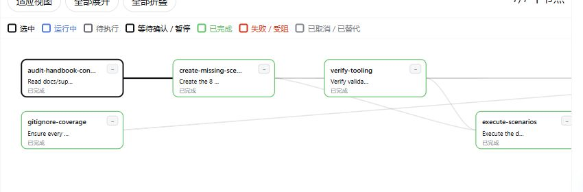

# Long Horizon Runtime · DSH 长任务插件

中文 | [English](README.en.md)

> 把一件很长的事，变成一条可确认、可跟踪、可恢复的任务。

> 如果这个插件帮你保住过一场长任务，请给仓库点个 ⭐，让更多受"任务中断、进度丢失"困扰的人找到它。

[它解决什么问题](#它解决什么问题) · [快速开始](#快速开始) · [怎么使用](#怎么使用)

Long Horizon Runtime 是 [DeepSeek Harness](https://github.com/deepseek-harness/deepseek-harness) 的长任务插件。它适合研究、开发、排障、资料整理这类需要拆步骤、持续推进的工作：先看计划，确认后执行；过程随时可见，任务中断也能接着做。

## 它解决什么问题

|  | 普通对话 | 加上 Long Horizon Runtime |
| --- | --- | --- |
| 做一件复杂的事 | 过程都在聊天记录里 | 先给出一份可确认的任务计划，再按步骤推进 |
| 看进度 | 需要翻对话 | 在 Task Area 直接看任务步骤、依赖和当前状态 |
| 中途改变方向 | 重新描述需求，容易丢掉上下文 | 修改目标后保留已完成工作，再生成新的后续计划 |
| 对话被暂停或中断 | 需要自己找回进度 | 回到同一任务，继续未完成的步骤 |



## 快速开始

需要已安装 DeepSeek Harness，并能正常运行 `dsh web`。从 GitHub 安装还需要 Node.js `^22.19.0` 或 `>=24.0.0` 与 pnpm。

### 从 GitHub 安装

```bash
dsh plugin --profile web add github:ynymhrb/long-horizon-runtime#master
dsh web
```

### 安装本地检出

在仓库根目录执行：

```bash
dsh plugin --profile web add .
dsh web
```

## 怎么使用

不用切换模式，像平常一样说清楚你要完成的事。例如：

```text
研究 RAG 召回率的影响因素；拆成可验证的子任务，先给我计划，等我确认再执行。
```

插件会把它整理成一条长任务：

1. 给出分步骤的计划；
2. 你确认后开始执行；
3. 在 Task Area 中查看每一步的状态和结果；
4. 需要暂停、改目标或换一段对话时，继续同一个任务即可。

你也可以直接这样说：

```text
暂停 lt_abc123。
把 lt_abc123 的目标改为“只研究中文技术资料”。
继续 lt_abc123，告诉我还有哪些步骤没完成。
```

## 会话驱动：一次控制动作只发一条

Web 侧点击「确认执行」「继续任务」只会推进一次任务控制版本，但真正派发节点还需要一条「请以当前会话为父级调用 `long_task_resume`」的驱动消息。这条消息由 `client/task-driver.js` 统一负责：**同一个会话、同一个任务、同一个控制版本只注入一次**，任务面板（Task Area）与输入区任务条共用这一份去重状态，因此不会因为两个面板都观察到同一状态变化、页面重挂载或轮询周期而重复注入。

- 注入成功后，「继续执行会话」按钮变为「驱动已发送，等待执行」并禁用；默认 60 秒宽限期过后才允许重新发送，避免人工连点再产生一条排队消息。
- 注入真实失败（宿主拒绝或抛错）时立即允许重试，失败原因显示在按钮旁。
- 该去重只作用于 Web 侧驱动消息的自动/人工触发；任务本身的状态、事件与重规划仍然完全由持久层决定。
- 修复前已经排队过的重复驱动消息不会被自动清理，刷新会话后按正常消息处理即可。

## 暂停由操作者说了算

任务区里点「暂停」是操作者的决定，**不会被代理自动撤销**：

- 暂停来源会被持久记录（`operator` / `agent` / `system`）。由你暂停的任务，代理再调用 `long_task_resume` 会被明确拒绝，并收到「任务已被操作者暂停，请在任务区继续」的提示，而不是悄悄把任务重新拉起来。
- 属于系统行为的恢复（重启后的恢复扫描、额度恢复定时器）同样不会覆盖你的暂停；被拒绝时会留下 `operator_pause_respected` 决策记录。
- 代理自己暂停的任务（例如自动重规划失败、会话被停止）仍然允许代理恢复，不会被误锁。
- 暂停/继续失败或与其他操作发生版本冲突时，界面会明确提示并刷新到最新状态，不再静默忽略。
- 想继续执行时，在任务面板点「继续任务」或「继续执行会话」即可，这是唯一能解除操作者暂停的入口。

## 本地多 Worker 与可配置编排

在 DSH Web 打开 **设置 → 长任务**，可以调整执行器和执行组、模型与工具额度，以及编排模板。
保存写入当前 Web 用户 patch 的长任务设置覆盖，任务规划或执行期间需等到空闲再保存。
Codex、Claude Code 与自定义命令由宿主配置登记，API 密钥由 DSH 的「模型」管理。

默认模式 `dynamic` 沿用 Planner 动态子图和 DSH 子 Agent 的节点内执行循环。
可在配置中注册工作流和讨论模板，或在 DSH 聊天中为当前目标指定流程。
配置和路径的完整示例见 [orchestration.cordis.example.yml](examples/orchestration.cordis.example.yml)。

- `maxConcurrentTasks` 是单次控制端装配内跨目标的执行尝试上限，也是单目标每轮的派发上限。
  每个 `workers[].maxConcurrent` 还限制该后端的执行数。名额等待期间不创建执行尝试。
  外部 Worker 使用同一工作目录时，写入尝试独占该目录。
- `executionProfiles[].workerIds` 为一个执行配置列出可用后端。已注册 Worker 的 ID
  也可直接用作执行配置 ID。角色需要的能力先校验，再在可用后端中按当前负载选择。
  普通动态计划使用默认执行配置，固定的阶段角色绑定通过工作流或讨论定义表达。
- `modelEndpoints` 通过已经在 DSH 注册的 `provider/model` 标识模型 API。默认角色
  为 `planner` 和 `execution`，DSH 执行配置可显式设置 `modelRole`。
  端点额度覆盖 DSH 子 Agent 的模型请求流。Codex 和 Claude CLI 使用各自的认证和服务配置，
  插件对它们限制的是同时运行的进程数。
- `toolConcurrency` 按 DSH 工具的注册名限制受管子 Agent 的工具调用。
  将额度配置给叶子工具。持有工具额度的调用如果嵌套进入另一个受限工具，会直接结束并报告错误。

聊天示例：

- 「用 code-delivery 模板做这个需求，先让我确认。」
- 「设计用 claude，设计评审用 codex，最多退回两次，过审后用 coding 组开发。」
- 「让 A、B、C 依次发言 10 轮，由 api-analysis 总结共识和分歧。」

Skill 可以要求模型调用 `long_task_create`，用 `workflow_template` 传模板 ID，
或者用 `orchestration_json` 传完整定义。已保存的流程随目标持久化。
需要改流程时，先在任务区暂停，再通过 `long_task_propose_workflow` 传新定义、原因和当前控制修订。
只有能保留已完成阶段的提案才会生成待确认修订，最终从任务区确认。

工作流中 `maxVisits: 3` 表示首次执行加最多两次返工。评审阶段通过 `onChangesRequested`
指定退回目标，并提交一个 `review` 产物，内容为 `{"verdict":"approved","reason":"..."}`
或 `{"verdict":"changes_requested","reason":"..."}`。评审返回退回意见时会展开新节点。
讨论中所有参与者各发言一次算一轮。可选 `convergence` 会调用主持人在完整轮次之后
判断是否提前收敛。达到轮数上限时由主持人总结。发言节点应在结果中更新累计摘要。

### 注册自定义 Worker

`custom-exec` 的 `executable` 和 `cwd` 使用绝对路径，`args` 是固定参数列表。
Windows 上为 npm 安装的 CLI 可指定原生可执行文件，或以 Node 可执行文件配合 CLI 的 JS 入口。
Codex 和 Claude 适配器的 `args` 用于可执行文件前缀，`cliArgs` 用于 `codex exec` 或 `claude -p` 的选项。
进程使用配置目录作为工作区。需要额外传入认证环境变量时，通过 `environmentKeys` 列出变量名。

进程从 stdin 读取一行 JSON，包含 `protocolVersion: 1`、`taskId`、`attemptId`、
`revision`、`workspace` 和 `context`。stdout 使用逐行 JSON，日志走 stderr。
可选事件为 `started`（`sessionId`）和 `progress`（`message`），最终提交一次：

```json
{"type":"result","result":{"status":"succeeded","summary":"已完成","artifacts":[{"type":"note","content":"任务结果"}],"evidence":[]}}
```

执行器需退出并返回成功的进程退出码，控制端随后独立验证结果。外部进程的工作区权限由部署者配置。
单机执行池通过进程内名额控制并发。跨宿主部署需要独立的租约与传输实现。
