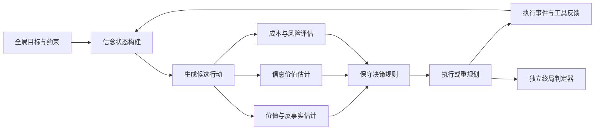

# 目标条件因果优势评测设计

日期：2026-09-20

## 1. 目标与研究问题

本研究考察：当 Agent 在长程软件工程任务中持续面对多个局部实现选择时，如何利用全局目标、历史状态与真实执行反馈，判断当前行动是否仍然有助于最终目标。

研究产物同时服务于理论方法论、可重复实验和 Agent 岗位面试。所有效果结论必须由可执行证据支持；模型自述、局部任务完成状态和单次成功案例均不构成效果证据。

核心研究问题为：

1. 能否定义一个目标条件的局部行动贡献，使其区分“产生局部进展”与“提高最终成功概率”？
2. 在部分可观测、反馈延迟和世界模型失配的条件下，真实执行反馈能否改善该贡献的估计？
3. 使用贡献估计控制继续、探测、重规划和人工确认，是否改善最终正确率、错误路线长度和成本？

## 2. 理论模型

将长程任务表示为目标条件化的部分可观测序贯因果决策过程。在时刻 `t`：

- `G` 是最终目标、完成标准和全局约束；
- `S_t` 是不可完全观察的真实项目状态；
- `H_t=(O_0,A_0,...,O_t)` 是截至当前的执行历史；
- `b_t=P(S_t|H_t)` 是 Agent 对真实状态的信念；
- `A_t` 是修改、诊断、验证、重规划或请求确认等行动；
- `O_{t+1}` 是测试、构建、静态检查、文件差异和工具错误等真实反馈；
- `Y_G` 是由独立终局判定器给出的目标效用。

固定后续控制策略 `pi_c`，定义目标条件因果优势（Goal-Conditioned Causal Advantage，GCCA）：

```text
GCCA_t(a, a'; G)
  = E[Y_G | do(A_t=a), b_t, pi_c]
  - E[Y_G | do(A_t=a'), b_t, pi_c]
```

固定后续策略用于隔离当前行动的边际作用，避免把后续 Agent 行为差异错误归因到当前选择。对候选集合 `A(d)`，行动的相对贡献定义为：

```text
GCCA*_t(a) = E[Y_G | do(A_t=a), b_t, pi_c]
             - max_{a' != a} E[Y_G | do(A_t=a'), b_t, pi_c]
```

在线控制分数为：

```text
J_t(a) = GCCA_hat_t(a)
         + lambda * EVI_t(a)
         - alpha * Cost_t(a)
         - beta * IrreversibilityRisk_t(a)
         - gamma * ConstraintRisk_t(a)
```

`EVI` 表示行动对关键不确定性的期望信息价值。该项使“先运行诊断再修改”即使没有立即提高局部完成度，也可能成为最优行动。

本研究不声称从任意自然语言轨迹中无条件识别真实因果效应。GCCA 的识别范围严格限定为：给定初始快照、候选行动集合、随机化干预和固定后续策略下的平均干预效应。真实任务中无法遍历的反事实只报告估计值和不确定区间。

## 3. 研究假设

- **H1，排序有效性：** GCCA 估计与实验反事实排序的一致性高于局部完成度和普通长期价值评分。
- **H2，控制有效性：** 使用 GCCA 控制行动能提高最终任务成功率，并缩短错误路线持续长度。
- **H3，反馈有效性：** 移除真实执行反馈后，排序准确率和最终成功率下降。
- **H4，信息价值：** 在诊断有助于区分潜在故障原因的任务上，加入 EVI 会提高诊断行动的选择准确率。
- **H5，风险有效性：** 加入不可逆性和约束风险会降低约束违规与错误自动重规划，但增加部分时间和 token 成本。

## 4. 与已有研究的关系

本研究借鉴但不等同于以下方向：

- SWE-bench 将真实 GitHub 问题和测试环境用于软件工程 Agent 的终局评测，说明软件仓库适合作为长程交互环境；本研究进一步观测关键决策点的行动级贡献。[SWE-bench](https://arxiv.org/abs/2310.06770)
- SWE-agent 表明 Agent 与计算机接口的设计会显著影响软件工程表现，因此实验必须固定工具接口，只改变决策策略。[SWE-agent](https://arxiv.org/abs/2405.15793)
- AgentBench 将多轮开放环境中的决策能力作为独立评测对象；本研究收窄到长程软件工程和局部行动的全局贡献。[AgentBench](https://arxiv.org/abs/2308.03688)
- 因果 MDP 将状态转移和奖励的因果结构引入序贯决策；本研究把结构先验具体化为代码依赖、测试覆盖、任务依赖和约束关系。[Efficient Reinforcement Learning with Prior Causal Knowledge](https://proceedings.mlr.press/v177/lu22a.html)
- 双重稳健离策略评估结合行为策略概率与价值模型；本研究将其作为真实轨迹上的次级估计器，不用它替代随机化分支实验。[Doubly Robust Off-policy Value Evaluation for Reinforcement Learning](https://proceedings.mlr.press/v48/jiang16.html)、[Double Reinforcement Learning](https://proceedings.mlr.press/v119/kallus20b.html)

## 5. 基准设计

### 5.1 两层基准

实验由两层组成：

1. **可控反事实层：** 从同一代码和运行时快照分叉，实际执行所有候选行动，获得给定控制策略下的反事实近似真值。
2. **真实 Agent 层：** 在从未用于调参的任务上随机分配决策方法，检验方法能否改善最终结果。

可控层建立内部有效性；真实层建立有限的外部有效性。二者分别报告，不跨层平均。

### 5.2 任务族

正式基准包含六类软件工程任务：

1. 局部测试通过但全局回归失败；
2. 先诊断与立即修改之间的选择；
3. 错误行动只在后续集成阶段暴露；
4. 初始任务分解或依赖已被证据否定；
5. 高代价、难回滚或约束敏感的变更；
6. 文档、测试、类型和运行行为提供矛盾证据。

每个任务定义：

- 不可变初始快照和依赖指纹；
- 全局目标、硬约束和预算；
- 2 至 4 个关键决策点；
- 每个决策点 3 个语义明确、可执行的候选行动；
- 隐藏终局测试和约束判定器；
- 固定后续策略与随机种子集合；
- 预期因果结构，但不把最优行动标签暴露给被测方法。

### 5.3 反事实分支

在决策点保存代码、事件数据库、产物、预算、上下文摘要和随机种子。每个候选行动在隔离工作区中执行，随后使用相同控制策略继续到终止。

对行动 `a` 的实验潜在结果为：

```text
Y_hat(a) = mean_j Oracle(rollout(snapshot, a, pi_c, seed_j))
```

终局效用由以下可审计部分组成：

- 目标测试是否通过；
- 非目标回归测试是否保持；
- 构建与类型检查是否通过；
- 全局约束是否满足；
- 是否产生重复或禁止的副作用；
- 在正确性相同时，规范化成本是否更低。

正确性是词典序第一优先级，禁止用低成本抵消错误结果。

### 5.4 数据泄漏控制

- 调参集与测试集使用不同仓库、缺陷模板和依赖图形态；
- 隐藏测试、最优行动标签和分支结果不进入提示词；
- 随机化文件名、行动顺序与表面描述；
- 为每个任务保留“局部进展高、全局贡献负”的困难负例；
- 保存提示词、工具集、模型参数和代码快照哈希；
- 证据缺失的运行标记为 `inconclusive`，不得按零收益或失败填充。

## 6. 对照方法与完整方法

所有方法使用相同模型、上下文、候选行动、工具、预算和终局判定器。

### 6.1 B0：局部进展基线

仅根据当前子任务完成度、最近测试结果和行动直接成本排序。这代表常见的短视 Agent。

### 6.2 B1：目标条件价值基线

要求模型估计每个行动的长期终局价值 `Q_hat(H_t,a,G)`，但不显式构造干预对照，也不分离信息价值和风险。

### 6.3 B2：反事实贡献方法

对每个候选行动生成结构化结果假设，使用共享后续策略进行有限模拟，估计相对于最佳替代行动的 GCCA。估计器输出均值、方差、证据引用和关键前提。

### 6.4 M：完整方法

在 B2 上加入 EVI、成本、不可逆性、约束风险和保守决策规则。若最优与次优行动的置信区间重叠，优先选择可逆的诊断行动；若所有候选行动的保守下界为负，则重规划或请求人工确认。

### 6.5 次级离策略分析

当真实任务无法执行所有反事实分支时，使用日志行为概率和结果模型形成双重稳健估计。该结果只作为稳健性分析。若行为概率缺失、支持集不重叠或有效样本量过低，则明确拒绝给出因果结论。

## 7. 在线数据流



每个决策记录必须包含：决策点 ID、目标版本、候选行动、选择概率、估计分量、置信度、使用的证据引用、实际反馈和终局结果。自然语言理由只作审计补充，不参与指标真值计算。

## 8. 实验设计

### 8.1 阶段划分

1. **确定性单元实验：** 使用固定 fixture 验证分支、指标、排序和报告逻辑。
2. **12 任务试验：** 每类两个任务，用于发现天花板、地板效应并估计方差。
3. **36 任务正式实验：** 每类六个任务，调参冻结后运行。
4. **真实模型随机对照：** 对每个任务、方法和随机种子进行配对运行。
5. **稳健性实验：** 更换预算、反馈噪声、延迟长度和后续控制策略。

### 8.2 主要指标

- **反事实排序准确率：** 被测排序与分支实验排序的一致程度；
- **最佳行动命中率：** 是否选择实验效用最高的行动；
- **GCCA 均方误差：** 估计贡献与实验贡献的差异；
- **最终任务成功率：** 独立终局判定器通过率；
- **错误路线长度：** 首个否定性证据出现后，继续错误方向的 durable 步骤数；
- **重规划时机误差：** 实际重规划点与 oracle 最早安全重规划点的距离；
- **约束违规率和重复副作用数；**
- **token、墙钟时间、工具调用和重试成本。**

最终成功率和最佳行动命中率为共同主要终点；其余为解释性和安全指标。

### 8.3 消融实验

- 移除真实执行反馈，只使用初始目标与计划；
- 移除反事实比较，仅保留普通价值评分；
- 移除 EVI；
- 移除不可逆性和约束风险；
- 不更新信念状态，只追加原始日志；
- 将固定后续策略替换为不同控制策略，测量估计敏感性。

### 8.4 随机化与统计

- 以任务和随机种子为区组，对方法做区组内随机排列；
- 模型、温度、工具、上下文预算和超时保持一致；
- 二元结果使用配对置换检验或分层逻辑回归；
- 连续指标使用任务级 bootstrap 置信区间；
- 排序使用 Kendall `tau` 和最佳行动命中率；
- 同时报告效应量、95% 置信区间与原始分母，不只报告 `p` 值；
- 试验阶段只估计方差与排查任务质量，不用于选择性报告正式结论；
- 正式实验前冻结场景版本、指标代码和分析脚本哈希。

不预先假设重复次数。12 任务试验结束后，依据主要终点方差做功效分析；若预计预算超过硬上限，则减少次级稳健性实验，不削弱主要对照。

## 9. 工程架构

新增 `validation/decision-quality`，与生产运行时隔离：

- `contract.mjs`：验证任务、决策点、候选行动和 oracle 契约；
- `branch-runner.mjs`：复制快照并执行受控反事实分支；
- `scorers.mjs`：实现 B0、B1、B2 和 M 的统一接口；
- `metrics.mjs`：计算排序、成功、漂移、风险与成本指标；
- `report.mjs`：生成机器可读 JSON 与中文 Markdown 报告；
- `cli.mjs`：提供 `validate`、`run-fixture`、`aggregate` 和显式 `run-live`；
- `schemas/`：保存版本化任务定义；
- `fixtures/`：只包含小型、无网络、可重复的测试仓库；
- `README.md`：记录运行方式、安全边界和证据解释。

生产路径不默认加载实验模块。`pnpm test` 只运行确定性测试，绝不调用模型。真实实验只能由显式命令启动，并要求：

- 唯一临时工作区；
- 禁止网络工具和第三方写入；
- API 密钥只从 `DEEPSEEK_API_KEY` 环境变量读取；
- 密钥不写入提示词、报告、证据包或子进程参数；
- 每次运行有 token 和墙钟硬预算；
- 检测到工作区外写入或外部副作用立即硬停止。

## 10. 证据包

每个运行产生不可变证据目录：

- `manifest.json`：运行 ID、场景版本和所有文件哈希；
- `environment.json`：代码、模型、工具和参数指纹；
- `decision.json`：候选行动、选择概率、分数分量和证据引用；
- `trajectory.json`：durable 步骤、反馈和状态摘要；
- `oracle.json`：隐藏判定器结果；
- `usage.json`：token、时间、工具调用和重试；
- `branch-outcomes.json`：仅可控层保存的干预分支结果；
- `verdict.json`：`pass`、`fail`、`inconclusive` 或 `hard_stop`。

报告聚合按场景版本、模型指纹和方法版本分区。不同模型或提示词版本不得直接合并。

## 11. 失败处理与可证伪性

- 模型拒绝结构化输出：记录失败并按预定义次数重试，不静默修复数据；
- oracle 无法运行：该次运行为 `inconclusive`；
- 候选行动无法执行：保留为行动可行性失败，不从分母删除；
- 反事实分支受到非预期状态污染：整组配对失效并重新生成快照；
- 行为策略概率不可得：禁用离策略因果估计；
- 置信区间重叠：报告无法区分，不强行宣布某方法更优；
- H1 或 H2 不成立：保留负结果，分析是估计误差、决策规则还是基准缺乏区分度。

本方法可以被以下结果证伪：GCCA 排序不优于普通价值评分；排序改善但不转化为最终成功率；执行反馈消融无显著影响；收益仅来自更高 token 消耗；换用后续控制策略后行动排名大幅反转。

## 12. 测试策略

所有行为先写失败测试。最低覆盖包括：

- 契约拒绝缺少全局目标、候选行动、固定策略或 oracle 的场景；
- 同一快照的分支互不污染；
- 正确计算已知潜在结果下的 GCCA、排序和成本；
- 正确处理并列、缺失证据、不可执行行动和 `inconclusive`；
- 报告排序稳定、重复运行字节一致；
- API 密钥和敏感环境变量不会进入证据包；
- 默认测试与构建不启动模型、不访问网络；
- live 命令缺少显式开关、预算或密钥时安全失败。

## 13. 资源计划

1 亿 token 是不可突破的硬上限，不是消费目标。预算按以下优先级分配：

1. 试验任务和方差估计；
2. 四种主要方法的正式配对实验；
3. 反馈、反事实和风险三项核心消融；
4. 预算与控制策略稳健性实验；
5. 其他探索性分析。

每阶段设置累计 token 门禁。前一阶段未达到证据完整性与任务区分度要求时，不进入下一阶段。

## 14. 面试叙事与证据边界

项目的面试主线为：

> 我把长程 Agent 的局部决策问题形式化为目标条件化的序贯因果决策问题。系统不以“子任务完成”作为进展，而是结合真实执行反馈，估计当前行动相对于替代行动对最终目标的干预效应，并把信息价值、成本和不可逆风险纳入控制。为了避免把模型自评当真值，我构建了能从同一代码快照执行多个行动分支的反事实基准，再用真实 Agent 随机对照验证这种估计是否改善最终任务结果。

当前仓库已经验证的事实与未来实验结果必须分开。实现前只能声称“提出设计”；确定性测试通过后可声称“实现可重复的反事实评测基础设施”；只有真实运行及分析完成后，才能声称某方法在指定任务、模型和预算下带来效果。

## 15. 完成标准

- 理论定义、识别假设和失败条件明确；
- 确定性反事实 fixture 能端到端运行并生成不可变证据；
- 四种方法共享同一评分接口，可完成消融比较；
- 指标与报告通过单元测试和重复性验证；
- 12 任务试验可由显式 live 命令启动；
- 密钥与外部副作用安全边界有自动测试；
- 输出研究方案、实验结果模板和面试讲解材料；
- 所有效果主张附带证据位置、样本量与置信区间。
